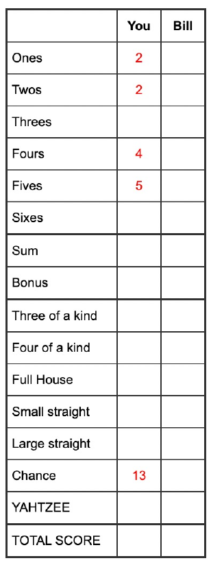

# Yatzy

Yatzy is a public domain dice game similar to Yahtzee, where players take turns rolling 5 dice. After each roll, the player chooses which dice to keep, and which ones to re-roll. A player may reroll some or all of the dice up to 2 times on a turn. The player must either score or enter 0 into a score box at the end of each turn. The game ends when all score boxes are used and the player with the highest total score wins the game!

## Scoring in Yatzy

The scoring sheet contains two sections

If a player manages to score at least 63 points (an average of three of each number) in the upper section, they are awarded a bonus of 50 points.

- Three of a Kind: Three dice showing the same number. Score: Sum of those three dice.
- Four of a Kind: Four dice with the same number. Score: Sum of those four dice.
- Small Straight: The combination 1-2-3-4-5. Score: 15 points (sum of all the dice).
- Large Straight: The combination 2-3-4-5-6. Score: 20 points (sum of all the dice).
- Full House: Any set of three combined with a different pair. Score: Sum of all the dice.
- Chance: Any combination of dice. Score: Sum of all the dice.
- Yatzy: All five dice with the same number. Score: 50 points.